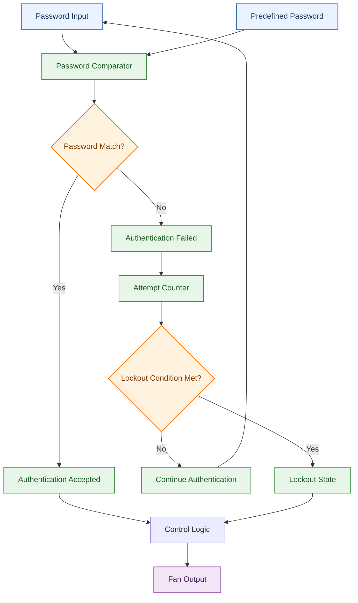
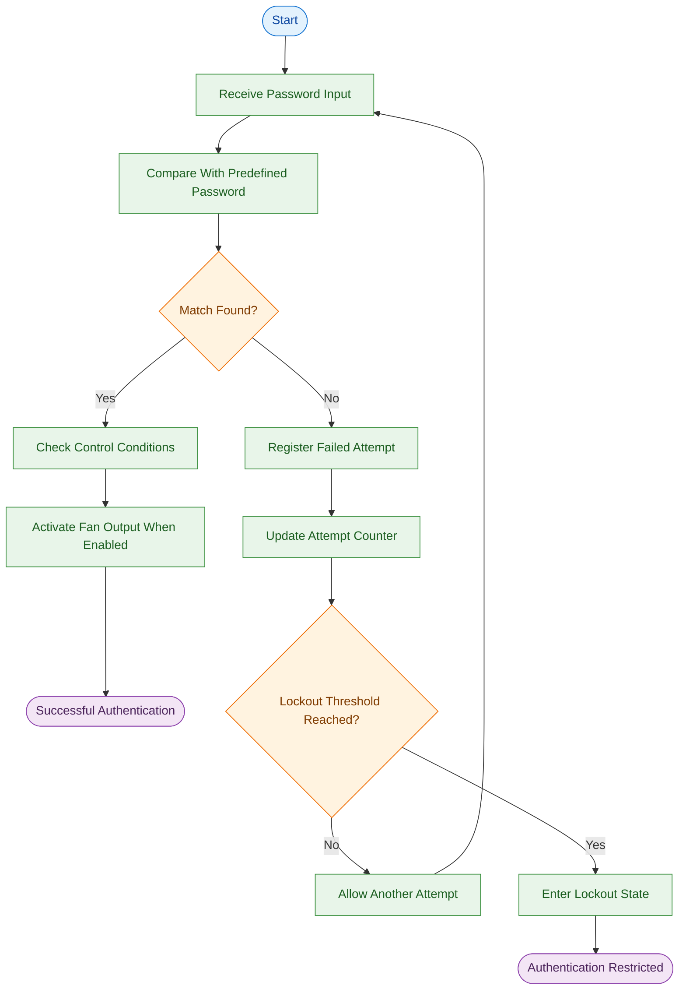

 

# DIGITAL LOCK SYSTEM

### A Password-Based Digital Lock Prototype Using VHDL

**A digital security system designed to validate password inputs, control access, and manage failed authentication attempts.**

---

## Overview

The **Digital Lock System** is a password-based digital security prototype developed using **VHDL (VHSIC Hardware Description Language)** and Xilinx ISE 14.7.

The project demonstrates the fundamental logic behind a digital access-control mechanism. It compares an entered password against a predefined password and uses the comparison result to control the system's output. It also incorporates an attempt counter and lockout logic to handle repeated failed authentication attempts.

The design is developed and verified as a software-based prototype using VHDL source code and a testbench. It demonstrates how digital logic concepts can be applied to a practical security-related application.

> **Core concept:** Enter a password → Verify the input → Control the output → Manage authentication attempts.

## Project Objectives

The primary objectives of this project are to:

- Implement password verification using VHDL.
- Compare entered password bits with a predefined password.
- Control the system output according to the authentication result.
- Track unsuccessful authentication attempts.
- Incorporate lockout logic for repeated failed attempts.
- Simulate and verify the design using a VHDL testbench.
- Demonstrate the application of digital logic and control flow in a security-oriented system.

## Key Features

| Feature | Description |
|---|---|
| Password Verification | Compares the entered password with the predefined password. |
| Password Matching | Determines whether the entered input matches the stored reference. |
| Output Control | Uses the authentication result and the relevant control signal to determine the fan output. |
| Attempt Counter | Tracks failed authentication attempts. |
| Lockout Logic | Implements a lockout mechanism after repeated failed attempts. |
| VHDL Testbench | Provides a simulation environment for checking the design's behaviour. |
| Simulation Files | Includes the supplied input and output files associated with the project. |

## System Architecture

The system follows a straightforward digital authentication pipeline. Password input is checked against the predefined password, and the resulting authentication status is used by the control logic to determine the output.

*The diagram illustrates the conceptual architecture of the project. The precise behaviour of the control signals and lockout mechanism is determined by the implemented VHDL logic.*

## System Workflow

The authentication process can be understood through the following stages.

### Workflow Stages

| Stage | Function |
|---|---|
| Password Input | Receives the password bits supplied to the system. |
| Password Comparison | Checks the entered password against the predefined password. |
| Authentication Decision | Determines whether the password is correct. |
| Output Control | Determines the fan output according to the password result and relevant control signals. |
| Failed Attempt Handling | Records unsuccessful authentication attempts. |
| Attempt Counting | Maintains the count used by the lockout logic. |
| Lockout Handling | Restricts further authentication when the implemented lockout condition is met. |

## Password Verification Logic

Password verification is the central operation of the system.

The comparator evaluates the entered password against the predefined password. When the values match, the authentication logic can permit the successful path. Otherwise, the failed-attempt handling logic is used.

The testbench includes a password example of `1010`.

| Input condition | Expected interpretation |
|---|---|
| Entered password matches the predefined password | Password comparison succeeds. |
| Entered password does not match | Authentication failure is registered. |
| Correct password with the relevant enable/control signal asserted | The fan output can be activated according to the implemented logic. |
| Repeated unsuccessful attempts | The attempt counter and lockout logic handle the failures. |

**Example:** During the documented testbench scenario, the password `1010` is used with the enter signal asserted and the fan output is observed as `1`.

The exact input combinations, counter limits, and reset behaviour should be interpreted from the supplied VHDL source and testbench.

## Digital Logic Design

The project brings together several foundational digital design concepts.

### 1. Password Comparator

The comparator checks whether the entered password and the predefined password are equal. Its result forms the basis of the authentication decision.

### 2. Control Logic

The control logic determines how the system responds to the comparison result and the relevant input signals. It governs the relationship between authentication and the fan output.

### 3. Attempt Counter

The attempt counter tracks unsuccessful authentication attempts. It supports the system's response to repeated incorrect password entries.

### 4. Lockout Mechanism

The lockout mechanism uses the implemented attempt-counting logic to restrict authentication after the specified failure condition is reached.

Together, these components demonstrate how combinational decision-making and sequential control can be organised into a small digital security system.

## Simulation and Verification

The project includes a VHDL testbench and associated input/output files for simulation and verification.

The testbench provides a way to apply inputs to the design and observe its responses without requiring a physical lock circuit.

The verification process focuses on:

- Password comparison behaviour.
- The effect of the relevant control signals.
- Fan output behaviour under the tested conditions.
- Failed-attempt handling.
- Attempt-counter and lockout behaviour.

The supplied testbench and simulation files serve as the reference for the scenarios actually exercised by the project.

> **Verification note:** Simulation demonstrates the behaviour of the digital design under the tested conditions. It does not, by itself, establish the reliability or security of a physically deployed locking device.

## Technology Stack

| Component | Technology |
|---|---|
| Hardware Description Language | VHDL |
| Design and Simulation Environment | Xilinx ISE Design Suite 14.7 |
| Verification | VHDL Testbench |
| Supporting Script | Python (`main.py`) |
| Version Control and Hosting | GitHub |

The Python script is included among the project files. Its precise role is defined by its implementation and is not assumed to be part of the VHDL authentication path.

## Repository Contents

The repository contains the project's source and supporting files:

| File category | Purpose |
|---|---|
| Main VHDL source (`.vhd`) | Contains the digital lock design. |
| Testbench | Provides the simulation test environment. |
| Input files | Supply the input data used by the project's workflow or simulations. |
| Output files | Contain the associated output data or results. |
| Python script (`main.py`) | Provides the project's supporting Python component. |

The exact filenames and their individual responsibilities can be identified from the files present in the repository.

## Project Scope and Limitations

This project is a **software-based prototype of a digital lock system**. It demonstrates the design and simulation of password verification and related control logic.

The current project should not be interpreted as a complete physical security product. A practical deployment would require additional considerations, including hardware implementation, physical interfacing, secure password storage, protection against repeated attacks, and testing under real-world conditions.

The project's purpose is to demonstrate digital logic design principles and the implementation of a password-controlled system in a simulation environment.

## Future Scope

The design could be extended in several directions:

- **Hardware Implementation:** Implement the design on a compatible FPGA development board.
- **Physical Lock Integration:** Interface the control logic with an appropriate locking mechanism.
- **User Interface:** Add a keypad or other physical input interface for password entry.
- **Enhanced Security:** Investigate stronger authentication and password-protection mechanisms.
- **Extended Verification:** Expand the testbench to cover additional input combinations, reset scenarios, and boundary conditions.

These are possible future extensions rather than features claimed to be implemented in the current version.

## Learning Outcomes

This project provides practical exposure to:

- Writing and organising VHDL source code.
- Translating a real-world concept into digital logic.
- Designing password-comparison and output-control logic.
- Understanding counters and conditional state handling.
- Using a testbench to simulate a design.
- Working with Xilinx ISE 14.7.
- Documenting and maintaining a technical project using GitHub.

## Conclusion

The Digital Lock System demonstrates how a password-controlled authentication mechanism can be represented and tested through VHDL.

By combining password comparison, control logic, output handling, attempt counting, and lockout behaviour, the project brings together several fundamental concepts in digital system design.

Although it remains a software prototype rather than a complete physical security device, it provides a practical foundation for exploring digital authentication and control systems.

**DIGITAL LOCK SYSTEM**

*Designed in VHDL. Tested through simulation. Documented for continued learning.*

